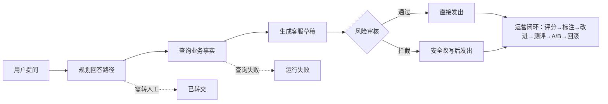
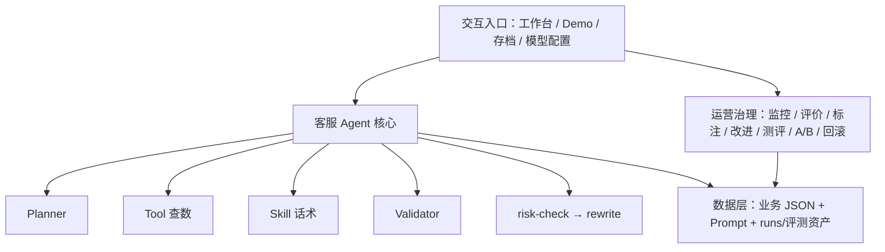

# SnackOps 作品集附录 · 示意图素材

可直接上传 Notion 的矢量图：

| 文件 | 内容 |
| --- | --- |
| `01-business-flow.svg` | 业务流程图 |
| `02-module-structure.svg` | 功能模块结构图 |
| `03-priority.md` | 需求 P0/P1/P2 优先级清单（含分层取舍逻辑） |

## 贴进 Notion 的建议

1. 把两个 `.svg` 拖进 Notion 页面（或先用浏览器打开 → 截图 / 导出 PNG）。
2. 图下可加一句说明（见下）。
3. 若 Notion 支持 Mermaid 代码块，也可粘贴本文「附录 B」。

### 图注文案（可复制）

**业务流程图**  
用户提问后，系统先规划回答路径，再查询商品/价格/订单等事实并生成回复；发送前经风险审核：通过则发出，拦截则安全改写后发出。查询失败标记运行失败且不假装成功；需人工时转交。发出后可通过评分、标注、改进、测评与 Prompt A/B 收回坏回复并回滚。

**功能模块结构图**  
产品为单客服 Agent 编排（Plan + Skill + Tool），外加风险审核与计划校验；运营侧覆盖监控、评价、标注、改进、测评、版本与回滚；底层为本地业务事实与策略/评测资产。

**需求优先级（`03-priority.md`）**  
页面可见处只放「分层总览表 + 三条核心取舍」；P0/P1/P2 的完整明细表格在 `
` 折叠块里，贴进 Notion 后分别选中 → Turn into → Toggle，默认收起，面试官想抠细节再点开。

---

## 附录 B · Mermaid（可选）

### 业务流程图

### 功能模块结构

