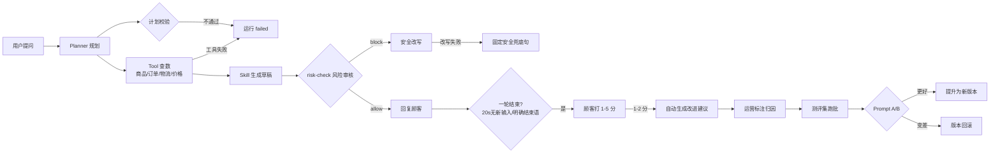
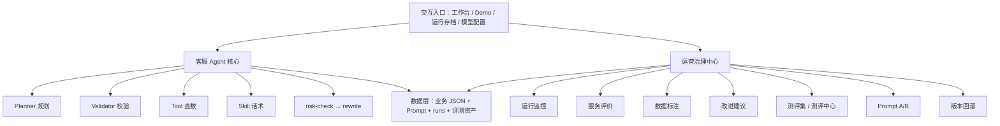

# SnackOps｜电商 AI 客服 Agent 质量治理平台

## ① 项目基础信息

| 项 | 内容 |
| --- | --- |
| 项目名称 | SnackOps｜电商 AI 客服 Agent 质量治理平台 |
| 项目周期 | 2026.09 – 2026.10（约 1 个月，个人作品集项目） |
| 项目角色 | 产品经理：独立完成需求调研、PRD、信息架构与运营模块设计；使用 Cursor 完成可运行 Demo POC |
| 目标用户 | 零食电商商家的客服运营团队 / 客服主管（B 端） |
| 项目定位 | 不是再造一个客服机器人，而是 AI 客服之上的**质量治理运营台**：把 Agent 每次回复拆成可检查、可打分、可回滚的步骤，让"答坏了"可被发现、被收回、被验证改进 |
| 一句话价值 | 让 B 端商家敢把 AI 客服接进真实对话——出问题看得见，改坏了退得回 |

---

## ② 项目背景与业务痛点

零食电商客服高频处理四类问题：商品推荐、价格优惠、物流动态、售后退换。接入 AI 客服后，业务方真正头疼的不是"模型会不会聊天"，而是三件事：

1. **答错了，却答得很顺。** Agent 是黑盒——这次回复是查了订单算出来的，还是模型自己编的？工具调用失败时，它能用一句顺滑的客服口吻把事故盖过去，运营根本察觉不到。
2. **上线后，坏回复收不回来。** 顾客已经看到了错误答案（尤其是"中奖要转账验证"这类安全问题），但系统里没有一个固定入口把它捞出来、标注、改、再验证。
3. **想改 prompt，不敢改。** 运营知道哪句话答得不好，但改完没有回归手段——改对了是运气，改坏了没人知道，更退不回上一版。

> 本项目以一条贯穿坏案例定义需求：**"客服说我中奖了，让我转账验证才能兑奖。"** 系统必须识别这是风险，拦截转账/验证码要求，回复明确让用户停止操作；且整次运行可追溯到规划、工具、话术和风险结论。

---

## ③ 调研与需求来源

**调研方式**：以 B 端客服运营的日常工作流为对象做桌面推演，用一条真实感坏案例（中奖转账诱导）贯穿式定义需求，不依赖虚构访谈样本。

**需求假设（我的三条核心判断）**：

| 假设 | 推演依据 | 对应产品动作 |
| --- | --- | --- |
| 客服质量问题的根因不是"模型不够强"，而是"过程不可见" | 一次回复由规划、查数、话术、审核多步拼成，黑盒状态下任何一步错都无法定位 | 把运行拆成六步留痕，运行详情可回看完整 trace |
| 安全问题不能靠模型自觉，必须独立审核 + 硬底线 | 转账、验证码、功效承诺这类错误，话术再流畅也是事故，不能让"语义复议"翻案 | 独立 risk-check 层；安全硬失败记 FAIL，Judge 也不能改成通过 |
| 运营改 prompt 是高频动作，没有版本和测评兜底就等于不敢改 | 改话术的人不是写代码的人，且改完无法证明"比上一版好" | Skill/Planner 编辑即打版本快照；改进必须经测评跑批才能提升 |

**竞品对照结论**：市面通用 AI 客服产品的能力普遍集中在"对话本身"（能接消息、能生成回复），缺运营侧的三件事——运行可观测、改完可回归、变差可回滚。SnackOps 的切入口就是把这后三件事做成独立运营台，而不是在聊天窗口里再加按钮。

---

## ④ 关键工作（产品视角）

1. **定义角色与主场景**：拆出"顾客"和"运营"两个角色——顾客要的是一轮说完再评分（不被每句话打断），运营要的是从低分一路追回到版本。
2. **设计运行链路与状态机**：固定六步顺序（规划 → 计划校验 → 工具查数 → 技能生成 → 风险审核 → 转人工），四种终态（succeeded / failed / handed_off / running）；计划或工具失败就记 failed，**不用客服口吻把事故说圆**。
3. **设计运营中心模块群**：运行监控、服务评价、数据标注、改进建议、测评集与测评中心、Prompt A/B、版本回滚——七个模块按"发现问题 → 归因 → 改 → 验证 → 回滚"串成闭环。
4. **定义指标口径**（不拍数字，先定义怎么算）：技术成功率 =（成功+转交）/ 已结束；自动解决率 = 仅 succeeded；人工接管率 = 仅 handed-off；另看平均耗时与 P95。
5. **设计评分交互**：一轮回复后不立即弹分；20 秒无新输入或用户说"不用了/再见"才出现 1–5 分；1–2 分自动生成一条改进建议。
6. **设计安全审核规则分层**：规则分负责底线（安全硬失败，不可复议），Judge 负责语义（质量类失败满足条件可复议为通过）；否定句里的敏感词不算承诺（"不能宣称降血糖"是合格拒绝）。
7. **定义双模型模式**：Demo 本地确定性模式（零 Key 可演示完整链路）与真实模型模式；**真实模式缺 Key 时报结构化错误，绝不静默退回 Demo 答案**。
8. **搭建可运行 POC**：用 Cursor 按 PRD 把上述链路做成可交互 Demo，覆盖工作台、运行存档、运营中心全部页面。

---

## ⑤ 需求优先级规划

**高层总览**：

| 档位 | 目标 | 包含模块 |
| --- | --- | --- |
| **P0** | 验证架构命题 | Demo 零依赖演示 · Agent 六步运行管线 · 业务查数工具 · 运行留痕 |
| **P1** | 做到可上线运营 | 真模型多厂商接入 · Skill/Planner 可编辑+版本快照 · 运行监控 · 测评跑批与标注 |
| **P2** | 构建数据改进飞轮 | 坏回复改进闭环 · Prompt A/B 实验 · 版本回滚中心 · LLM-as-Judge |

**三条核心取舍**：

1. **先证明编排对，再换发动机。** P0 用本地确定性 Demo 跑通整条链路，而不是急着接真模型——架构错了换什么模型都白搭；架构对了，接 DeepSeek 还是 GPT 只是换个 Base URL。
2. **安全和性能是第一天的事。** 风险审核（拦截+改写）和"运行列表不塞全量 trace、记录封顶 200 条"放在 P0，因为它们决定的是"敢不敢给人看"。
3. **运营飞轮是数据依赖的，顺序不能倒。** 监控、测评、标注是 P1 的基建；改进、A/B、回滚是 P2 的飞轮——没有前者攒下的数据和版本，后者就是空界面。

▶ 展开：完整 P0/P1/P2 需求明细清单（待粘贴）

（此处贴 `docs/portfolio/03-priority.md` 中三张完整明细表）

---

## ⑥ 项目成果 & POC 价值

Demo 环境跑通完整闭环，样本运行 31 条（去重后）：

| 指标 | Demo 实测值 | 口径 |
| --- | --- | --- |
| 技术成功率 | **97%** |（成功+转交）/ 已结束 |
| 自动解决率 | **84%**（26 条） | 仅终态 succeeded |
| 人工接管率 | **13%**（4 条） | 仅终态 handed_off |
| 平均耗时 | 7098 ms（P95 11604 ms） | 单次运行端到端 |
| 风险审核 | allow 31 / block 0 | 拦截与分布可见 |
| 失败定位 | 1 条失败可定位到具体步骤 `tool/calculate_price` | 失败不再是黑盒 |

**POC 验证了什么**：

- "把 AI 客服回复拆步留痕 + 运营侧改进闭环"这条产品路线在工程上可落地；
- 运营可以直观看到 Agent 在哪一步失败、风险是否命中，而不是只看一个最终回复；
- 从"顾客打低分 → 进改进 → 跑测评 → A/B 对比 → 提升或回滚"整条链路在 Demo 里可演示。

**诚实边界**（主动写进作品集，避免面试翻车）：以上是演示环境样本，订单/物流为本地样例数据，无真实生产流量、无权限系统、无客服队列；不将其表述为"已在某公司上线"。

---

## ⑦ 附件素材区

▶ 展开：PRD 原文《一次坏回复如何被收回》（待粘贴）

（此处贴 `docs/prd-bad-reply-recovery.md` 全文）

▶ 展开：完整需求清单 / 版本快照说明（待粘贴）

（此处贴 `docs/portfolio/03-priority.md` 明细表）

- 业务流程图：`docs/portfolio/01-business-flow.svg`
- 功能模块结构图：`docs/portfolio/02-module-structure.svg`
- Demo 截图：运营中心监控页（含 KPI 卡片、状态分布图、风险与失败区）
- 运行详情页：展示单次运行六步 trace、风险结论、评分对照

---

## ⑧ 配套 Mermaid 流程图

**业务流程图（一次回复的生命周期）：**

**功能模块结构图：**

---

## 附：面试口述话术（约 60 秒）

这个项目叫 SnackOps，是一个给零食电商商家用的 AI 客服质量治理平台。起因是我发现一个普遍问题：现在大家做 AI 客服，都在比谁的模型答得好，但商家真正怕的是——答错了你看不见，改坏了你退不回。

所以我没有再做一个聊天机器人，而是做了它上面的运营台。核心是把 Agent 每次回复拆成六步：规划、校验、查数、生成、风险审核、转人工，全程留痕；答错了能定位到具体哪一步，比如 Demo 里有一条失败我就标在了"价格计算工具"上。

运营侧我搭了完整的改进闭环：顾客一轮聊完打低分，低分自动生成改进建议，运营归因后必须跑测评集、做 A/B，才能把新 prompt 提上线；变差了一键回滚。这里有个我比较坚持的设计——安全问题是硬底线，模型说"中奖要转账"这种，风险审核直接拦截，而且测评里这类安全硬失败连 Judge 都不能改成通过。

Demo 跑了 31 条样本，自动解决率 84%，人工接管率 13%，平均耗时 7 秒。我知道这是演示环境不是生产数据，所以面试时我会主动讲清楚边界——这个项目我想验证的不是"AI 客服能不能用"，而是"B 端为了敢用 AI 客服，需要一套什么样的治理工具"。
